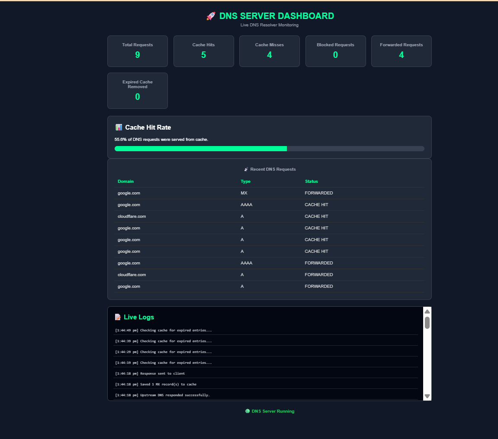

# Custom DNS Resolver

A custom DNS resolver built with **Node.js** that processes DNS queries, forwards requests to upstream DNS providers, caches DNS records, blocks specified domains, and provides a real-time monitoring dashboard.

The project explores how DNS works internally, including DNS packet structure, record parsing, UDP communication, caching, and TCP fallback.

## Dashboard

## Features

- **DNS Resolution** — Resolves DNS queries for A, AAAA, CNAME, and MX records.
- **UDP Forwarding** — Forwards DNS requests to external upstream resolvers using UDP.
- **Upstream Failover** — Tries multiple DNS providers if a resolver fails.
- **TCP Fallback** — Switches to TCP when a UDP response is truncated.
- **DNS Caching** — Stores DNS responses with TTL-based expiration.
- **LRU Cache** — Uses a Hash Map and Doubly Linked List to efficiently manage cache entries and evict least recently used records.
- **Domain Blocking** — Blocks domains using a configurable blocklist.
- **DNS Packet Parsing** — Parses DNS headers, questions, compressed domain names, and supported answer records.
- **MX Record Support** — Preserves mail server priorities.
- **Monitoring Dashboard** — Displays request statistics, cache performance, recent DNS requests, and logs.
- **Error Handling** — Handles upstream failures, timeouts, malformed responses, and DNS `SERVFAIL` responses.

## Tech Stack

- Node.js
- JavaScript
- Express.js
- UDP (`dgram`)
- TCP (`net`)
- DNS Protocol
- HTML
- CSS

## Architecture

The resolver follows this flow:

Client → Custom DNS Resolver → Blocklist / Cache → Upstream DNS → Response

1. The client sends a DNS query to the local resolver.
2. The resolver parses the domain name and requested record type.
3. The blocklist is checked.
4. If the domain is blocked, a blocking response is generated.
5. Otherwise, the resolver checks its cache.
6. If a valid cache entry exists, it returns the cached result.
7. If the cache misses, the query is forwarded to an upstream DNS server.
8. If an upstream server fails, another configured upstream may be attempted.
9. If a UDP response is truncated, the resolver retries over TCP.
10. The response is parsed, relevant records are cached, and the response is sent to the client.

## Project Structure

\`\`\`
dns-server/
├── cache/
│   ├── cacheManager.js
│   ├── LRUCache.js
│   └── Node.js
├── config/
│   └── config.js
├── forwarding/
│   └── dnsForwarder.js
├── logger/
│   └── logger.js
├── managers/
│   └── requestHistory.js
├── parser/
│   └── dnsParser.js
├── security/
│   └── blocklist.js
├── stats/
│   └── statsManager.js
├── notes/
├── dashboard.js
├── dnsClient.js
├── server.js
├── udpClient.js
├── testDnsServer.js
├── blocklist.txt
├── package.json
├── package-lock.json
└── .gitignore
\`\`\`

## Getting Started

### Prerequisites

- Node.js
- npm

### 1. Clone the repository

\`\`\`bash
git clone [https://github.com/Rounak-2108/dns-server.git](https://github.com/Rounak-2108/dns-server.git)
cd dns-server
\`\`\`

### 2. Install dependencies

\`\`\`bash
npm install
\`\`\`

### 3. Start the DNS resolver

\`\`\`bash
npm start
\`\`\`

The DNS server starts on:

\`\`\`
127.0.0.1:5300
\`\`\`

The monitoring dashboard is available at:

\`\`\`
[http://localhost:3000](http://localhost:3000)
\`\`\`

## Usage

The project includes a command-line DNS client for testing DNS queries against the custom resolver.

### Query an IPv4 address (A)

\`\`\`bash
node dnsClient.js google.com A
\`\`\`

### Query an IPv6 address (AAAA)

\`\`\`bash
node dnsClient.js google.com AAAA
\`\`\`

### Query a CNAME record

\`\`\`bash
node dnsClient.js google.com CNAME
\`\`\`

### Query mail servers (MX)

\`\`\`bash
node dnsClient.js google.com MX
\`\`\`

The client validates the DNS response, checks the transaction ID, verifies the question section, handles DNS response codes, and displays returned records and TTL values.

## DNS Cache

The resolver implements an in-memory DNS cache with:

- TTL-based expiration
- Cache hit and miss tracking
- Periodic removal of expired entries
- LRU eviction when cache capacity is reached

The LRU implementation combines:

- **Hash Map** — Provides fast lookup of cache entries.
- **Doubly Linked List** — Maintains usage order for efficient cache updates and eviction.

This design enables average O(1) cache lookup, insertion, and eviction operations.

## Domain Blocking

Domains can be added to the \`blocklist.txt\` file.

The blocklist is loaded when the server starts and stored in a JavaScript \`Set\` for efficient membership checks.

Blocked domains are handled locally without being forwarded to upstream DNS providers.

## Upstream DNS Providers

The resolver is configured to use multiple upstream DNS providers:

| Provider   | IP Address  |
| ---------- | ----------- |
| Google DNS | \`8.8.8.8\` |
| Cloudflare | \`1.1.1.1\` |
| Quad9      | \`9.9.9.9\` |

The resolver attempts to use alternative upstream servers when resolution fails and supports TCP fallback for truncated UDP responses.

## Monitoring Dashboard

The project includes a web-based dashboard for monitoring DNS activity.

Dashboard features include:

- Total DNS requests
- Cache hits and misses
- Cache hit rate
- Blocked requests
- Forwarded requests
- Expired cache entries removed
- Recent DNS request history
- Live server logs

The dashboard periodically fetches statistics from the server to refresh the displayed information.

## Configuration

Server settings are centralized in \`config/config.js\`.

Configurable parameters include:

- DNS server port
- Upstream DNS providers
- Default block IP
- Default TTL
- Cache capacity
- Cache cleanup interval
- Statistics interval
- Blocklist file path
- DNS forwarding timeout
- Client timeout

This allows the resolver's behavior to be adjusted without modifying its core logic.

## Testing Utilities

The repository includes testing utilities:

- \`dnsClient.js\` — Sends valid DNS queries for supported record types and validates responses.
- \`udpClient.js\` — Tests basic UDP packet delivery to the local server.
- \`testDnsServer.js\` — Used for development and controlled DNS forwarding/fallback testing.

## Limitations

This project is an educational custom DNS resolver and is not intended to replace production DNS infrastructure.

- Supports a limited set of DNS record types.
- Uses a simplified DNS parsing and response-handling implementation.
- Cache behavior is simplified for record sets with differing TTLs.
- The blocklist is loaded at startup.
- The resolver has not undergone a comprehensive security audit or production-scale testing.

## Learning Outcomes

Through this project, I explored and implemented:

- DNS protocol fundamentals and packet structure
- UDP and TCP socket programming in Node.js
- DNS header and question parsing
- DNS compression pointers
- DNS record parsing
- TTL-based caching
- LRU cache design using data structures
- Upstream failover and timeout handling
- UDP truncation and TCP fallback
- Modular backend architecture
- Monitoring and request statistics

## Future Improvements

- Support for additional DNS record types
- Stronger DNS packet validation
- Improved IPv6 handling and validation
- More comprehensive automated tests
- Enhanced cache and blocklist configuration
- Dashboard security and input sanitization

---

**Built as a learning project to understand DNS resolution, networking, and the internal workings of a DNS resolver.**
